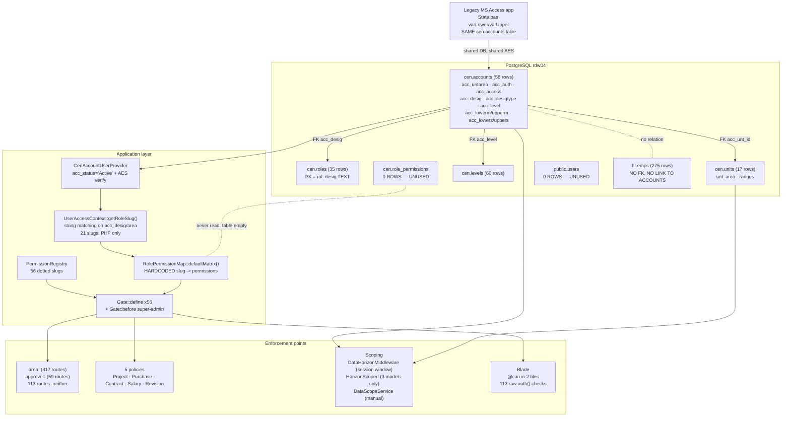

# RDWIS 2.0 — RBAC & User-Flow Discovery Report

**Scope:** read-only discovery of how users, roles, permissions and data scoping work today.
**Date:** 9 November 2026
**Codebase:** `H:\RDWIS 2.0\RDWIS APP 2.0` — Laravel 12, PHP 8.2
**Live database:** PostgreSQL 18.4, database `rdw04` on `127.0.0.1:5433`

## Method and read-only guarantee

Every SQL statement ran through a wrapper that issues `SET default_transaction_read_only = on;`
before anything else, so writes were impossible at the server level. Proof:

```
$ psql ... -c "SET default_transaction_read_only = on;" -c "CREATE TABLE zzz_probe(i int);"
SET
ERROR:  cannot execute CREATE TABLE in a read-only transaction
```

No migrations, seeders, writes or DB-writing tests were run. Role resolution was exercised by
calling existing application methods through `artisan tinker --execute` (reads only).

Two conventions used throughout:

- **✅ CONFIRMED** — backed by a pasted query result or a `file:line` citation.
- **❓ OPEN QUESTION** — not determinable from code or data alone.

One security item below (F-10) was confirmed by reading code and checking which files exist on
disk. No HTTP request was made against the vulnerable endpoint, so it is reported as
code-confirmed and still needs a runtime check by the team.

---

# PART 1 — Database: RBAC tables

## 1.1 Discovery query

```sql
SELECT table_schema, table_name FROM information_schema.tables
WHERE table_name ILIKE ANY (ARRAY['%user%','%role%','%perm%','%right%','%access%',
  '%group%','%menu%','%module%','%unt%','%unit%','%desig%','%priv%'])
ORDER BY 1,2;
```

Raw output, application schemas only (the `information_schema` and `pg_catalog` rows are
PostgreSQL's own and are excluded here):

```
    table_schema    |            table_name
--------------------+-----------------------------------
 cen                | accounts
 cen                | role_permissions
 cen                | roles
 cen                | units
 cen                | user_case_draft_remarks
 cen                | user_quick_remarks
 hr                 | bnkaccounts
 prj                | mprgroup
 public             | users
```

The pattern list **missed three RBAC-relevant tables**. Listing the whole `cen` schema found them:

```sql
SELECT table_name, table_type FROM information_schema.tables WHERE table_schema='cen' ORDER BY 1;
```

```
       table_name        | table_type
-------------------------+------------
 accounts                | BASE TABLE
 globalvars              | BASE TABLE
 heads                   | BASE TABLE
 levels                  | BASE TABLE
 role_permissions        | BASE TABLE
 roles                   | BASE TABLE
 routes                  | BASE TABLE
 system_settings         | BASE TABLE
 units                   | BASE TABLE
 user_case_draft_remarks | BASE TABLE
 user_quick_remarks      | BASE TABLE
 version                 | BASE TABLE
```

✅ CONFIRMED — the RBAC-relevant set is: `cen.accounts`, `cen.roles`, `cen.role_permissions`,
`cen.units`, `cen.levels`, `cen.routes`, `cen.globalvars`, `public.users`.
`cen.user_quick_remarks`, `cen.user_case_draft_remarks`, `hr.bnkaccounts` and `prj.mprgroup`
matched the pattern by name only and carry no authorization data.

All 14 application schemas:

```
aud, cen, doc, fin, frm, gen, hr, ina, prj, public, pur, puritems, purnew, sup
```

## 1.2 Table structures

### `cen.accounts` — the user table

```
                                       Table "cen.accounts"
     Column      |           Type           | Nullable |           Default
-----------------+--------------------------+----------+------------------------------
 acc_id          | integer                  | not null | generated always as identity
 acc_unt_id      | integer                  | not null |
 acc_level       | smallint                 | not null |
 acc_type        | character varying(255)   | not null |
 acc_reportlevel | integer                  |          |
 acc_username    | character varying(255)   | not null |
 acc_pass        | character varying(255)   | not null |
 acc_startdt     | timestamp with time zone | not null |
 acc_status      | character varying(255)   | not null |
 acc_enddt       | timestamp with time zone |          |
 acc_name        | character varying(255)   | not null |
 acc_title       | character varying(255)   |          |
 acc_rank        | character varying(255)   |          |
 acc_desig       | character varying(255)   | not null |
 acc_desigshort  | character varying(255)   | not null |
 acc_desigtype   | character varying(10)    | not null |
 acc_lowerm      | integer                  | not null |
 acc_upperm      | integer                  | not null |
 acc_access      | character varying        | not null |
 acc_lowers      | integer                  | not null |
 acc_uppers      | integer                  | not null |
 acc_untname     | character varying        | not null |
 acc_untnamesh   | character varying        | not null |
 acc_unttype     | character varying        | not null |
 acc_auth        | character varying        | not null |
 acc_untarea     | character varying        | not null |
Indexes:
    "accounts_pk" PRIMARY KEY, btree (acc_id)
    "accounts_un" UNIQUE CONSTRAINT, btree (acc_username)
Foreign-key constraints:
    "accounts_fk"   FOREIGN KEY (acc_desig)  REFERENCES cen.roles(rol_desig) ON UPDATE CASCADE ON DELETE RESTRICT
    "accounts_fk_1" FOREIGN KEY (acc_unt_id) REFERENCES cen.units(unt_id)
    "accounts_fk_2" FOREIGN KEY (acc_level)  REFERENCES cen.levels(lvl_id)
Referenced by:
    gen.case_attachments.gca_uploader_id       -> acc_id  ON DELETE RESTRICT
    gen.case_movements.gcm_actor_id            -> acc_id  ON DELETE RESTRICT
    gen.case_movements.gcm_from_holder_id      -> acc_id  ON DELETE SET NULL
    gen.case_movements.gcm_to_holder_id        -> acc_id  ON DELETE SET NULL
    gen.case_notes.gcn_author_id               -> acc_id  ON DELETE RESTRICT
    gen.cases.gcs_created_by                   -> acc_id  ON DELETE RESTRICT
    gen.cases.gcs_current_holder_id            -> acc_id  ON DELETE SET NULL
    doc.documents.creator_id                   -> acc_id
    doc.documents.current_owner_id             -> acc_id
    doc.document_versions.action_by            -> acc_id
    sup.ticket_activities.act_user_id          -> acc_id  ON DELETE CASCADE
    sup.tickets.tkt_solved_by                  -> acc_id  ON DELETE SET NULL
    sup.tickets.tkt_user_id                    -> acc_id  ON DELETE CASCADE
```

Note the denormalisation: `acc_untname`, `acc_untnamesh`, `acc_unttype`, `acc_untarea`,
`acc_desigshort`, `acc_desigtype`, `acc_access`, `acc_auth`, `acc_level` and the four range
columns are all copies of values that also live in `cen.units` and `cen.roles`. Section 5.2
shows where those copies have drifted apart.

### `cen.roles`

```
                             Table "cen.roles"
     Column      |          Type          | Nullable | Default
-----------------+------------------------+----------+---------
 rol_unt_id      | integer                | not null |
 rol_level       | smallint               | not null |
 rol_desig       | character varying(255) | not null |
 rol_desigshort  | character varying(255) | not null |
 rol_desigtype   | character varying(255) | not null |
 rol_reportlevel | smallint               |          |
 rol_access      | character varying      |          |
 rol_auth        | character varying      |          |
Indexes:
    "desigs_pk" PRIMARY KEY, btree (rol_desig)
Foreign-key constraints:
    "roles_fk" FOREIGN KEY (rol_unt_id) REFERENCES cen.units(unt_id)
Referenced by:
    cen.accounts.acc_desig -> rol_desig  ON UPDATE CASCADE ON DELETE RESTRICT
```

✅ CONFIRMED — the primary key is the **full designation text**, not a surrogate id. A role is
identified by a human-readable string such as `Director Sensors and UAV Technology`. Renaming a
designation rewrites the key and cascades into every account row.

### `cen.role_permissions`

```
                                            Table "cen.role_permissions"
   Column   |            Type             | Nullable |                     Default
------------+-----------------------------+----------+--------------------------------------------------
 id         | bigint                      | not null | nextval('cen.role_permissions_id_seq'::regclass)
 role_slug  | character varying(64)       | not null |
 permission | character varying(100)      | not null |
 created_at | timestamp without time zone |          | CURRENT_TIMESTAMP
Indexes:
    "role_permissions_pkey" PRIMARY KEY, btree (id)
    "idx_cen_role_permissions_slug" btree (role_slug)
    "uq_cen_role_permission" UNIQUE CONSTRAINT, btree (role_slug, permission)
```

Created by `database/migrations/2026_09_10_100000_create_cen_role_permissions_table.php`.
**This table holds zero rows** (section 1.3), so it currently contributes nothing. Note it keys on
`role_slug`, a value that exists only in PHP and has no foreign key to `cen.roles`.

### `cen.units`

```
                              Table "cen.units"
       Column       |          Type          | Nullable | Default
--------------------+------------------------+----------+---------
 unt_id             | integer                | not null |
 unt_type           | character varying(255) | not null |
 unt_name           | character varying(255) | not null |
 unt_namesh         | character varying(255) | not null |
 unt_lowerm         | integer                | not null |
 unt_upperm         | integer                | not null |
 unt_lowers         | integer                | not null |
 unt_uppers         | integer                | not null |
 unt_area           | character varying      |          |
 unt_leadname       | character varying      |          |
 unt_leadtitle      | character varying      |          |
 unt_leadrank       | character varying      |          |
 unt_leaddesig      | character varying      |          |
 unt_leaddesigshort | character varying      |          |
Indexes:
    "units_pk" PRIMARY KEY, btree (unt_id)
Referenced by:
    cen.accounts.acc_unt_id -> unt_id
    cen.roles.rol_unt_id    -> unt_id
    gen.cases.gcs_unt_id    -> unt_id  ON DELETE SET NULL
    sup.tickets.tkt_unt_id  -> unt_id  ON DELETE SET NULL
```

### `cen.levels`, `cen.routes`, `public.users`

```
                        Table "cen.levels"
 Column  |          Type          | Nullable | Default
---------+------------------------+----------+---------
 lvl_id  | smallint               | not null |
 lvl_cat | character varying(255) |          |
Indexes:
    "levels_pk" PRIMARY KEY, btree (lvl_id)
Referenced by:
    cen.accounts.acc_level -> lvl_id

                         Table "cen.routes"
  Column   |          Type          | Nullable | Default
-----------+------------------------+----------+---------
 rte_doc   | character varying(255) | not null |
 rte_steps | character varying(255) | not null |
Indexes:
    "routes_pk" PRIMARY KEY, btree (rte_doc)

                                             Table "public.users"
      Column       |              Type              | Nullable |              Default
-------------------+--------------------------------+----------+-----------------------------------
 id                | bigint                         | not null | nextval('users_id_seq'::regclass)
 name              | character varying(255)         | not null |
 email             | character varying(255)         | not null |
 password          | character varying(255)         | not null |
 email_verified_at | timestamp(0) without time zone |          |
 remember_token    | character varying(100)         |          |
 created_at        | timestamp(0) without time zone |          |
 updated_at        | timestamp(0) without time zone |          |
Indexes:
    "users_pkey" PRIMARY KEY, btree (id)
    "users_email_unique" UNIQUE CONSTRAINT, btree (email)
```

`public.users` is the stock Laravel table from
`database/migrations/0001_01_01_000000_create_users_table.php`. It is empty and unused: the auth
guard points at a custom provider instead (section 2.2).

## 1.3 Row counts

```sql
SELECT 'cen.accounts' AS tbl, count(*) FROM cen.accounts
UNION ALL SELECT 'cen.roles', count(*) FROM cen.roles
UNION ALL SELECT 'cen.role_permissions', count(*) FROM cen.role_permissions
UNION ALL SELECT 'cen.units', count(*) FROM cen.units
UNION ALL SELECT 'cen.levels', count(*) FROM cen.levels
UNION ALL SELECT 'cen.routes', count(*) FROM cen.routes
UNION ALL SELECT 'cen.globalvars', count(*) FROM cen.globalvars
UNION ALL SELECT 'public.users', count(*) FROM public.users
UNION ALL SELECT 'hr.emps', count(*) FROM hr.emps
ORDER BY 1;
```

```
         tbl          | count
----------------------+-------
 cen.accounts         |    58
 cen.globalvars       |     6
 cen.levels           |    60
 cen.role_permissions |     0
 cen.roles            |    35
 cen.routes           |     1
 cen.units            |    17
 hr.emps              |   275
 public.users         |     0
```

✅ CONFIRMED — **`cen.role_permissions` is empty and `public.users` is empty.** Every permission
decision therefore comes from the hardcoded PHP matrix in `app/Services/Auth/RolePermissionMap.php`
(section 2.4).

### `cen.roles` — all 35 rows

```
 rol_unt_id | rol_level |                        rol_desig                        | rol_desigshort | rol_desigtype | rol_reportlevel | rol_access | rol_auth
------------+-----------+---------------------------------------------------------+----------------+---------------+-----------------+------------+----------
      10000 |        59 | Deputy Director General NRDI                            | DDG NRDI       | lead          |              69 | single     | approver
     100000 |        11 | System Admin                                            | Sys Admin      | lead          |               0 | multiple   | approver
     100000 |        28 | Director Logistics                                      | DLOG           | lead          |              29 | multiple   | approver
     100000 |        35 | Director Planning And Coordination                      | DP&C           | lead          |              49 | multiple   | viewer
     100000 |        49 | Director General NRDI                                   | DG NRDI        | lead          |              49 | multiple   | viewer
     160000 |        27 | Subject Matter Expert                                   | SME            | lead          |              49 | multiple   | viewer
     160000 |        29 | Managing Director RDW                                   | MD RDW         | lead          |              49 | multiple   | viewer
     180000 |        25 | Director R&D                                            | DR&D           | lead          |              29 | multiple   | approver
     180000 |        25 | Staff Officer R&D                                       | SO R&D         | staff         |              29 | multiple   | approver
     200000 |        17 | Deputy Director Command, Control and Communication (C3) | DDC3           | staff         |              19 | single     | approver
     200000 |        19 | Director Command, Control and Communication (C3)        | DC3            | lead          |              29 | single     | approver
     250000 |        17 | Deputy Director AI and Immersive Technology             | DDAI&Emers     | staff         |              19 | single     | approver
     250000 |        19 | Director AI and Immersive Technology                    | DAI&Emers      | lead          |              29 | single     | approver
     300000 |        17 | Deputy Director Under Water Tech                        | DDUWT          | staff         |              19 | single     | approver
     300000 |        19 | Director Under Water Tech                               | DUWT           | lead          |              29 | single     | approver
     350000 |        17 | Deputy Director Sensors and UAV Technology              | DDS&UAV        | staff         |              19 | single     | approver
     350000 |        19 | Director Sensors and UAV Technology                     | DS&UAV         | lead          |              29 | single     | approver
     400000 |        17 | Deputy Director Radar and EW                            | DDREW          | staff         |              19 | single     | approver
     400000 |        19 | Director Radar and EW                                   | DREW           | lead          |              29 | single     | approver
     450000 |        17 | Deputy Director Ex Systems                              | DDExSys        | staff         |              19 | single     | approver
     450000 |        19 | Director Ex Systems                                     | DExSys         | lead          |              29 | single     | approver
     450000 |        19 | PI Ex Systems                                           | PI ExSys       | staff         |              29 | single     | approver
     800000 |        23 | Accounts Officer                                        | AccOfficer     | staff         |              25 | multiple   | approver
     800000 |        23 | Staff Officer Finance                                   | SO Finance     | staff         |              25 | multiple   | approver
     800000 |        25 | Director Finance                                        | DFin           | lead          |              29 | multiple   | approver
     810000 |        25 | Director Inventory and Procurement                      | DProc          | lead          |              29 | multiple   | approver
     820000 |        23 | Staff Officer HR                                        | SO HR          | staff         |              25 | multiple   | approver
     820000 |        25 | Director HR                                             | DHR            | lead          |              29 | multiple   | approver
     820000 |        25 | Manager HR                                              | MHR            | lead          |              29 | multiple   | approver
     840000 |        23 | Admin Officer                                           | AO             | staff         |              25 | single     | approver
     840000 |        25 | Director Admin                                          | DAdmin         | lead          |              29 | single     | approver
     840000 |        25 | Manager Admin                                           | MAdmin         | lead          |              29 | single     | approver
     860000 |        23 | Staff Officer IT&CYS                                    | SO IT&CYS      | lead          |              29 | multiple   | approver
     880000 |        25 | Manager IS                                              | MIS            | lead          |              29 | single     | approver
     990000 |        49 | MTSS Representative                                     | MTSS Rep       | lead          |              49 | multiple   | viewer
```

### `cen.units` — all 17 rows

```
 unt_id |   unt_type    | unt_namesh | unt_area | unt_lowerm | unt_upperm | unt_lowers | unt_uppers
--------+---------------+------------+----------+------------+------------+------------+------------
  10000 | Head Quarters | HQs NRD    | hqs      |     100000 |     999999 |      10000 |      99999
 100000 | Institute     | NRDI       | nrdi     |     100000 |     999999 |          0 |          0
 160000 | Wing          | RDW        | rdw      |     160000 |     999999 |          0 |          0
 180000 | Department    | Projects   | prj      |     160000 |     999999 |     180000 |     179999
 200000 | Division      | C3         | prj      |     160000 |     999999 |     200000 |     249999
 250000 | Division      | AI & Emers | prj      |     160000 |     999999 |     250000 |     299999
 300000 | Division      | UWT div    | prj      |     160000 |     999999 |     300000 |     349999
 350000 | Division      | S & UAV    | prj      |     160000 |     999999 |     350000 |     399999
 400000 | Division      | R & EW     | prj      |     160000 |     999999 |     400000 |     449999
 450000 | Division      | Ex Sys Div | prj      |     160000 |     999999 |     450000 |     499999
 800000 | Department    | Finance    | fin      |     160000 |     999999 |     800000 |     809999
 810000 | Department    | P & I      | fin      |     160000 |     999999 |     810000 |     819999
 820000 | Department    | HR         | hr       |     160000 |     999999 |     820000 |     839999
 840000 | Department    | Admin      | adm      |     160000 |     999999 |     840000 |     859999
 860000 | Department    | IT         | it       |     100000 |     999999 |     860000 |     879999
 880000 | Department    | IS         | is       |     160000 |     999999 |     880000 |     899999
 990000 | External      | EXT        |          |     160000 |     999999 |          0 |          0
```

The unit id itself encodes the hierarchy: divisions occupy 200000–499999 in 50000-wide blocks,
central departments 800000–899999. The `lowers/uppers` pair is that unit's own block and the
`lowerm/upperm` pair is its module-wide window. Section 2.8 explains how these become SQL filters.

### `cen.levels` (60 rows) and `cen.routes` (1 row)

`cen.levels` maps a numeric level to an organisational tier. Distinct categories, with their
`lvl_id` ranges:

| `lvl_id` range | `lvl_cat` |
|---|---|
| 11–20 | Department |
| 21–30 | R&D Wing |
| 31–40 | NRDI Department |
| 41–50 | NRDI |
| 51–60 | HQs Department |
| 61–70 | HQs NRDI |

```
 rte_doc |  rte_steps
---------+-------------
 MPR     | -5-(10)-15-
```

`cen.routes` holds a single row describing the MPR document route as an encoded step string.
❓ OPEN QUESTION — nothing in `app/` reads `cen.routes`; the MPR route is read from
`cen.globalvars.mpr_route` instead (see below). Whether `cen.routes` is dead or used by the legacy
application was not determined.

### `cen.globalvars` (6 rows)

```
       gvar_name       | gvar_value | gvar_type
-----------------------+------------+-----------
 att_cutoff_time       | 09:30:00   | time
 att_disregard         | 25 Jun 26  | date
 attstart_for_pay      | 26         | int2
 mpr_route             | -19-(25)-  | varchar
 salhead_applicable    | False      | boolean
 salreq_allow_multiple | 20 May 26  | date
```

These are shared runtime settings rather than permissions, but `mpr_route` encodes an approval
route as `-19-(25)-`, i.e. by `acc_level` numbers. That makes level numbers part of the
authorization surface.

## 1.4 The relationship chain

✅ CONFIRMED, from the foreign keys above:

```
cen.levels.lvl_id  <--  cen.accounts.acc_level
cen.units.unt_id   <--  cen.accounts.acc_unt_id
cen.units.unt_id   <--  cen.roles.rol_unt_id
cen.roles.rol_desig <-- cen.accounts.acc_desig      (role identified by designation text)
cen.accounts.acc_id <-- gen.*, doc.*, sup.*          (actor / holder / owner columns)
```

**There is no user-to-employee link in the database.** `hr.emps` has no foreign keys at all:

```sql
SELECT conname, pg_get_constraintdef(oid) FROM pg_constraint
WHERE conrelid='hr.emps'::regclass AND contype='f';
```

```
 conname | pg_get_constraintdef
---------+----------------------
(0 rows)
```

`hr.emps` columns are `emp_id, emp_cnic, emp_name, emp_joindt, emp_locked, emp_rank, emp_status,
emp_remarks, emp_unt_id, emp_hed_id, emp_lastdt, emp_title, emp_photodest, emp_cleared`. There is
no `emp_acc_id` and no `acc_emp_id`. The only connection between an account and an employee is
that both carry a unit id (`acc_unt_id` and `emp_unt_id`), joined implicitly in application code
with no referential integrity.

✅ CONFIRMED — **`user → employee` does not exist. The chain is `user → unit → (employees in that
unit)`.** Consequence: the system cannot answer "which employee record is this logged-in user?"

## 1.5 Spatie Permission

```sql
SELECT table_schema, table_name FROM information_schema.tables
WHERE table_name IN ('roles','permissions','model_has_roles','role_has_permissions','model_has_permissions')
ORDER BY 1,2;
```

```
 table_schema | table_name
--------------+------------
 cen          | roles
(1 row)
```

✅ CONFIRMED — **Spatie Permission is NOT installed.** `permissions`, `model_has_roles`,
`role_has_permissions` and `model_has_permissions` are all NOT FOUND. The single hit is the
project's own `cen.roles`, whose columns (section 1.2) bear no resemblance to Spatie's schema.

## 1.6 Distinct values in user-related columns

```sql
SELECT 'acc_type' AS col, acc_type AS val, count(*) FROM cen.accounts GROUP BY 2
UNION ALL SELECT 'acc_auth', acc_auth, count(*) FROM cen.accounts GROUP BY 2
UNION ALL SELECT 'acc_access', acc_access, count(*) FROM cen.accounts GROUP BY 2
UNION ALL SELECT 'acc_desigtype', acc_desigtype, count(*) FROM cen.accounts GROUP BY 2
UNION ALL SELECT 'acc_untarea', acc_untarea, count(*) FROM cen.accounts GROUP BY 2
UNION ALL SELECT 'acc_unttype', acc_unttype, count(*) FROM cen.accounts GROUP BY 2
UNION ALL SELECT 'acc_status', acc_status, count(*) FROM cen.accounts GROUP BY 2
ORDER BY 1,2;
```

```
      col      |     val      | count
---------------+--------------+-------
 acc_access    | multiple     |    35
 acc_access    | single       |    21
 acc_access    | Single       |     2     <-- casing inconsistency
 acc_auth      | approver     |    43
 acc_auth      | viewer       |    15
 acc_desigtype | head         |     2     <-- not present in cen.roles.rol_desigtype
 acc_desigtype | lead         |    49
 acc_desigtype | staff        |     7
 acc_status    | Active       |    21
 acc_status    | Closed       |    37
 acc_type      | Admin        |     1
 acc_type      | Standard     |    57
 acc_untarea   | adm          |     7
 acc_untarea   | fin          |     6
 acc_untarea   | hqs          |     1
 acc_untarea   | hr           |     4
 acc_untarea   | is           |     1
 acc_untarea   | it           |     5
 acc_untarea   | log          |     1
 acc_untarea   | mtss         |     1
 acc_untarea   | nrdi         |     7
 acc_untarea   | prc          |     1
 acc_untarea   | prj          |    13
 acc_untarea   | rdw          |     9
 acc_untarea   | rdwprj       |     2
 acc_unttype   | Department   |    23
 acc_unttype   | Division     |    13
 acc_unttype   | External     |     1
 acc_unttype   | Institute    |     6
 acc_unttype   | Organization |     4     <-- not present in cen.units.unt_type
 acc_unttype   | Wing         |    11
```

✅ CONFIRMED — there are **four independent authorization dimensions** on an account, none of
which is a single role field: `acc_untarea` (13 values), `acc_auth` (2 values), `acc_access`
(3 values once casing is counted), and `acc_desigtype` (3 values). `acc_type` exists with an
`Admin`/`Standard` split but section 2 shows it is never read by any code.

### The 21 active accounts

```sql
SELECT acc_id, acc_username, acc_unt_id, acc_level, acc_desigshort, acc_desigtype,
       acc_auth, acc_access, acc_untarea, acc_lowers, acc_uppers
FROM cen.accounts WHERE acc_status='Active' ORDER BY acc_unt_id, acc_level DESC;
```

```
 acc_id | acc_username  | acc_unt_id | acc_level | acc_desigshort | acc_desigtype | acc_auth | acc_access | acc_untarea | acc_lowers | acc_uppers
--------+---------------+------------+-----------+----------------+---------------+----------+------------+-------------+------------+------------
    108 | Mmaqbool      |     100000 |        59 | DDG NRDI       | lead          | approver | Single     | hqs         |          0 |          0
    107 | Mmazhar       |     100000 |        49 | DG NRDI        | lead          | approver | Single     | nrdi        |          0 |          0
    106 | kmahmood      |     100000 |        28 | DLOG           | lead          | approver | multiple   | log         |          0 |          0
    104 | superadminrdw |     100000 |        25 | Sys Admin      | lead          | approver | multiple   | it          |     100000 |     999999
    100 | mimran        |     160000 |        29 | MD RDW         | lead          | viewer   | multiple   | rdw         |          0 |          0
     36 | nislam2       |     180000 |        25 | SO R&D         | staff         | approver | multiple   | rdwprj      |     180000 |     179999
     14 | amushtaq      |     200000 |        19 | DC3            | lead          | approver | single     | prj         |     200000 |     249999
     15 | hraza         |     250000 |        19 | DAI&Emers      | lead          | approver | single     | prj         |     250000 |     299999
     16 | amemon        |     300000 |        19 | DUWT           | lead          | approver | single     | prj         |     300000 |     349999
     60 | tmiraj1       |     350000 |        19 | DS&UAV         | lead          | approver | single     | prj         |     350000 |     399999
     99 | arehman2      |     400000 |        19 | DREW           | lead          | approver | single     | prj         |     400000 |     449999
     62 | arehman       |     400000 |        17 | DDREW          | staff         | approver | single     | prj         |     400000 |     449999
    110 | amushtaq1     |     450000 |        19 | DExSys         | lead          | approver | single     | prj         |     450000 |     499999
     45 | frahman       |     800000 |        25 | DFin           | head          | approver | multiple   | fin         |     800000 |     809999
    109 | tahmed        |     800000 |        23 | SO Finance     | staff         | approver | multiple   | fin         |     800000 |     809999
     61 | mmuttaqi      |     810000 |        25 | DProc          | lead          | approver | multiple   | prc         |     810000 |     819999
     65 | basimt        |     820000 |        23 | SO HR          | staff         | approver | multiple   | hr          |     820000 |     839999
    103 | sajidali      |     840000 |        25 | MAdmin         | lead          | approver | single     | adm         |     840000 |     859999
     64 | mumer         |     860000 |        23 | SO IT&CYS      | lead          | approver | multiple   | it          |     860000 |     879999
     22 | amustafa      |     880000 |        25 | MIS            | lead          | approver | single     | is          |     880000 |     899999
     50 | mtanveer      |     990000 |        49 | MTSS Rep       | lead          | viewer   | multiple   | mtss        |          0 |          0
```

---

# PART 2 — Code: how RBAC is enforced

## 2.1 Packages

```
$ grep -nE "spatie|bouncer|laratrust|permission|sanctum|jetstream|fortify|breeze" composer.json
(no matches)
```

✅ CONFIRMED — `composer.json:9-15` requires only `php ^8.2`, `barryvdh/laravel-dompdf`,
`laravel/framework ^12.0`, `laravel/serializable-closure`, `laravel/tinker` and
`phpoffice/phpword`. **No authorization package of any kind.** The two `composer.lock` hits
(`spatie/once`, `laravel/sanctum`) are transitive entries of other packages, not direct
requirements. The entire RBAC layer is bespoke.

## 2.2 Models

| Concern | Location |
|---|---|
| Auth model | `app/Models/CenAccount.php:9` — `protected $table = 'cen.accounts'`, PK `acc_id` |
| Subclass | `app/Models/User.php:11` — `class User extends CenAccount` |
| Role relation | `app/Models/User.php:48` — `belongsTo(Role::class, 'acc_desig', 'rol_desig')` |
| Unit relation | `app/Models/User.php:53` — `belongsTo(Unit::class, 'acc_unt_id', 'unt_id')` |
| Custom provider | `app/Auth/CenAccountUserProvider.php` |
| Guard config | `config/auth.php:39-44` — guard `web` uses provider `cen_accounts` |
| Provider config | `config/auth.php:63-68` — driver `cen_accounts`, model `CenAccount` |

`CenAccount` carries a hand-written AES implementation compatible with the legacy Microsoft Access
application: `expandKey` at `CenAccount.php:122`, `aesRound` at `:165`, `encryptAES` at `:355`,
`hashPassword` at `:451`, `verifyPassword` at `:456`, plus a legacy salted-SHA fallback at `:423`.

### Role and permission helper methods

There is **no `hasRole()` and no `hasPermission()` on the user model.** Authorization helpers are
split across three places, and `User` duplicates methods already defined on its own parent:

| Method | On `CenAccount` | On `User` (subclass) | Behaviour differs? |
|---|---|---|---|
| `isSORD()` | `:516` | `:58` | both check `acc_untarea` |
| `isSuperAdmin()` | `:523` | not overridden | — |
| `isCentralDepartment()` | `:538` | `:65` | duplicated |
| `isMyDepartmentMode()` | `:547` | `:74` | duplicated |
| `isDivision()` | `:561` | `:88` | duplicated |
| `isFinance()` | `:570` | `:101` | duplicated |
| `isProcurement()` | `:580` | `:111` | duplicated |
| `isHr()` | `:590` | `:121` | duplicated |
| `isApprover()` | `:600` | `:131` | duplicated |
| `isViewer()` | `:605` | `:136` | duplicated |
| `canSeeRecord()` | `:618` | `:149` | duplicated |
| `isSingleUnitAccess()` | `:631` | `:162` | **yes, see F-04** |

A third copy of the same concepts lives in `app/Services/Auth/UserAccessContext.php`
(`isApprover():228`, `isViewer():261`, `isSingleAccess():277`). Section 5.2 shows a case where the
`User` and `UserAccessContext` versions return opposite answers for the same live account.

Note `isDlog()` at `User.php:185` and `isMdDdgDg()` at `:211` identify command officers by
matching designation substrings, `acc_auth` values and even **usernames**
(`in_array($username, ['dlog', 'logistics'], true)`).

## 2.3 Middleware

Registered in `bootstrap/app.php:19-36`:

| Alias / scope | Class | Registration | Logic |
|---|---|---|---|
| global (web, prepended) | `RestrictNetworkAccess` | `bootstrap/app.php:21` | IP allow/block list; `abort(403)` at `:52` and `:79`; localhost always allowed `:37` |
| global (web, prepended) | `SecurityHeaders` | `bootstrap/app.php:22` | response headers only |
| global (web, appended) | `DataHorizonMiddleware` | `bootstrap/app.php:25` | computes scope window, shares to all views |
| `area` | `CheckArea` | `bootstrap/app.php:32` | `abort(403)` at `CheckArea.php:43` |
| `approver` | `RequireApprover` | `bootstrap/app.php:33` | `abort(403)` at `:19` and `:24` |
| `force_password_change` | `ForcePasswordChange` | `bootstrap/app.php:34` | redirect at `:30` |
| not aliased | `RedirectIfDivision` | NOT FOUND in `bootstrap/app.php` | redirect at `:14` |
| not aliased | `RedirectIfSord` | NOT FOUND in `bootstrap/app.php` | redirect at `:14` |

✅ CONFIRMED — `RedirectIfDivision` and `RedirectIfSord` are **registered nowhere**. They are not
in the alias map at `bootstrap/app.php:32-35` and do not appear in `routes/web.php`. Dead classes.

### `CheckArea` — two bypasses

```
app/Http/Middleware/CheckArea.php:22   if (UserAccessContext::forUser($user)->isSuperAdmin()) return $next($request);
app/Http/Middleware/CheckArea.php:26   if (method_exists($user, 'isMyDepartmentMode') && $user->isMyDepartmentMode()) {
app/Http/Middleware/CheckArea.php:28       if (in_array('prj', $normalizedRequestedAreas, true) || in_array('rdwprj', ...)) {
app/Http/Middleware/CheckArea.php:29           return $next($request);
app/Http/Middleware/CheckArea.php:43   abort(403, 'Access denied. Your account is not authorized for this area.');
```

The second bypass means any central-department officer who has toggled "My Department" mode passes
**every** `area:prj` or `area:rdwprj` gate regardless of their own area. The toggle is a
session value the user sets themselves via `POST /user/toggle-scope`
(`app/Http/Controllers/DepartmentScopeController.php`), so it is self-asserted, not granted.

### `RequireApprover` — hardcoded designations

```
app/Http/Middleware/RequireApprover.php:18   if ($area === 'nrdi' && in_array($desigShort, ['DG', 'MD'], true)) {
app/Http/Middleware/RequireApprover.php:19       abort(403, 'This action is not available in command view.');
app/Http/Middleware/RequireApprover.php:23   if (! $user || ! in_array($auth, ['approver', 'editor'], true)) {
app/Http/Middleware/RequireApprover.php:24       abort(403, 'This action requires approver-level access.');
```

Line 18 hardcodes the short designations `DG` and `MD`. The live data has `DG NRDI` and `MD RDW`
as `acc_desigshort` (section 1.6), so **this condition never matches any current account** and the
"not available in command view" guard is inert. Line 23 reads `acc_auth` directly, which is the
only place in the stack where `acc_auth` is authoritative; section 5.2 F-02 shows the Gate layer
disagrees.

## 2.4 Gates and policies

There is **no `AuthServiceProvider`** — `app/Providers/` contains only `AppServiceProvider.php`.
All wiring is in its `boot()`:

```
app/Providers/AppServiceProvider.php:56   Gate::before(function ($user, $ability) {
app/Providers/AppServiceProvider.php:57       if ($user instanceof CenAccount && UserAccessContext::forUser($user)->isSuperAdmin()) {
app/Providers/AppServiceProvider.php:58           return true;
app/Providers/AppServiceProvider.php:62   foreach (PermissionRegistry::all() as $permission) {
app/Providers/AppServiceProvider.php:63       Gate::define($permission, function ($user) use ($permission) {
app/Providers/AppServiceProvider.php:65           return RolePermissionMap::hasPermission($user, $permission);
app/Providers/AppServiceProvider.php:72   Gate::policy(Project::class,    ProjectPolicy::class);
app/Providers/AppServiceProvider.php:73   Gate::policy(Purchase::class,   PurchaseCasePolicy::class);
app/Providers/AppServiceProvider.php:74   Gate::policy(HrCtrCase::class,  ContractCasePolicy::class);
app/Providers/AppServiceProvider.php:75   Gate::policy(FinSalOrder::class, SalaryOrderPolicy::class);
app/Providers/AppServiceProvider.php:76   Gate::policy(AudRev::class,     DataRevisionPolicy::class);
```

✅ CONFIRMED — a `Gate::before` super-admin override exists at `:56-60`. It returns `true` for
**every ability**, including all policy methods.

### Permission registry

`app/Services/Auth/PermissionRegistry.php` declares **56 permission constants** as dotted slugs,
grouped: `project.*` (4), `purchase.*` (12), `mpr.*` (6), `contract.*` (10), `finance.*` (3),
`salary.*` (4), `hr.employee.*` (2), `attendance.*` (2), `admin.*` (3), `reports.view`,
`support.ticket.*` (3), `reversal.*` (6).

### Role to permission matrix

`app/Services/Auth/RolePermissionMap.php:20` `defaultMatrix()` defines **21 role slugs**:

```
SUPERADMIN, COMMAND_DG, COMMAND_MD, COMMAND_DDG, COMMAND_DLOG, SORD,
DEPT_DIRECTOR_RD, DIV_DIRECTOR, DIV_OFFICER, DEPT_DIRECTOR_FIN, FIN_OFFICER,
PROC_DIRECTOR, PROC_OFFICER, HR_MANAGER, HR_OFFICER, IT_ADMIN, IT_OFFICER,
ADMIN_DEPT, IS_DEPT, MTSS_DEPT, USER
```

These slugs exist **only in PHP**. They are not in `cen.roles`, and `cen.role_permissions` (which
keys on them) is empty. Resolution path:

```
Gate::define(...)                          AppServiceProvider.php:63
  -> RolePermissionMap::hasPermission()     RolePermissionMap.php:425
     -> resolvePermissionsFor()             RolePermissionMap.php:376
        -> UserAccessContext::getRoleSlug() UserAccessContext.php:295
        -> loadDbOverrides()                RolePermissionMap.php:347  (reads the empty table)
```

### How a role slug is derived

`UserAccessContext::getRoleSlug()` at `app/Services/Auth/UserAccessContext.php:295-401`. It never
reads `cen.roles`. It runs an ordered cascade over `acc_untarea`, `acc_desig`, `acc_desigshort` and
`acc_desigtype`:

```
:305  isSuperAdmin()  -> SUPERADMIN
:309  isDg()          -> COMMAND_DG
:313  isMd()          -> COMMAND_MD
:317  isDdg()         -> COMMAND_DDG
:321  isDlog()        -> COMMAND_DLOG
:325  isSord()        -> SORD
:335  str_contains($desig, 'DIRECTOR R&D')  -> DEPT_DIRECTOR_RD
:340  isMyDepartmentMode() -> DIV_DIRECTOR | DIV_OFFICER
:348  isProcurement()      -> PROC_DIRECTOR | PROC_OFFICER
:356  isFinance()          -> DEPT_DIRECTOR_FIN | FIN_OFFICER
:364  isHr()               -> HR_MANAGER | HR_OFFICER
:372  isIt()               -> IT_ADMIN | IT_OFFICER
:380  area==='prj' OR area IN ('adm','admin') -> DIV_DIRECTOR | DIV_OFFICER
:388  area===ADMIN         -> ADMIN_DEPT
:392  area===IS            -> IS_DEPT
:396  area===MTSS          -> MTSS_DEPT
:400  fallback             -> USER
```

The lead/staff split inside each branch, for example at `:381`, is:

```php
if ($desigType === 'lead' || str_contains($desig, 'DIRECTOR') || str_contains($desig, 'MANAGER')) {
    return $this->roleSlug = 'DIV_DIRECTOR';
}
return $this->roleSlug = 'DIV_OFFICER';
```

### Measured result: role slug per live active account

Produced by calling `UserAccessContext::forUser()` and `RolePermissionMap::resolvePermissionsFor()`
on every `acc_status='Active'` row (read-only):

```
username      |desig      |unit   |RESOLVED_ROLE_SLUG|auth     |area     |#perm
--------------------------------------------------------------------------------------
kmahmood      |DLOG       |100000 |COMMAND_DLOG      |approver |log      | 13
Mmazhar       |DG NRDI    |100000 |COMMAND_DG        |approver |nrdi     | 13
Mmaqbool      |DDG NRDI   |100000 |COMMAND_DDG       |approver |hqs      | 13
superadminrdw |Sys Admin  |100000 |SUPERADMIN        |approver |it       | 55
mimran        |MD RDW     |160000 |COMMAND_MD        |viewer   |rdw      | 13
nislam2       |SO R&D     |180000 |SORD              |approver |rdwprj   | 11
amushtaq      |DC3        |200000 |DIV_DIRECTOR      |approver |prj      | 26
hraza         |DAI&Emers  |250000 |DIV_DIRECTOR      |approver |prj      | 26
amemon        |DUWT       |300000 |DIV_DIRECTOR      |approver |prj      | 26
tmiraj1       |DS&UAV     |350000 |DIV_DIRECTOR      |approver |prj      | 26
arehman       |DDREW      |400000 |DIV_DIRECTOR      |approver |prj      | 26
arehman2      |DREW       |400000 |DIV_DIRECTOR      |approver |prj      | 26
amushtaq1     |DExSys     |450000 |DIV_DIRECTOR      |approver |prj      | 26
frahman       |DFin       |800000 |DEPT_DIRECTOR_FIN |approver |fin      | 17
tahmed        |SO Finance |800000 |FIN_OFFICER       |approver |fin      | 15
mmuttaqi      |DProc      |810000 |PROC_DIRECTOR     |approver |prc      |  9
basimt        |SO HR      |820000 |HR_OFFICER        |approver |hr       | 13
sajidali      |MAdmin     |840000 |DIV_DIRECTOR      |approver |adm      | 26
mumer         |SO IT&CYS  |860000 |IT_ADMIN          |approver |it       | 15
amustafa      |MIS        |880000 |IS_DEPT           |approver |is       |  2
mtanveer      |MTSS Rep   |990000 |MTSS_DEPT         |viewer   |mtss     |  2
```

✅ CONFIRMED — only **11 of the 21 defined slugs** are reachable by any live active account.
`DIV_OFFICER`, `DEPT_DIRECTOR_RD`, `PROC_OFFICER`, `HR_MANAGER`, `IT_OFFICER`, `ADMIN_DEPT`,
`USER` and `COMMAND_*` variants beyond the four in use are unexercised. `ADMIN_DEPT` is
structurally unreachable (F-05).

### Viewer stripping

`app/Services/Auth/RolePermissionMap.php:394-417` removes mutating permissions from viewers:

```php
if ($context->isViewer()) {
    $allPermissions = array_values(array_filter($allPermissions, function ($perm) {
        if (str_starts_with($perm, 'support.ticket.')) return true;
        return ! (
            str_ends_with($perm, '.create')   || str_ends_with($perm, '.edit')    ||
            str_ends_with($perm, '.delete')   || str_ends_with($perm, '.submit')  ||
            str_ends_with($perm, '.manage')   || str_ends_with($perm, '.override')||
            str_ends_with($perm, '.approve')  || str_ends_with($perm, '.settle')  ||
            str_ends_with($perm, '.record')   || str_ends_with($perm, '.cancel')  ||
            str_ends_with($perm, '.initiate') || str_ends_with($perm, '.release') ||
            str_ends_with($perm, '.execute')  || str_ends_with($perm, '.return')
        );
    }));
}
```

The filter is **suffix-based**. The approval-action permissions are named `purchase.md_action`,
`purchase.dg_action`, `purchase.ddg_action`, `purchase.dlog_action`, `contract.md_action` and so
on. These end in `_action`, not any listed suffix, so **a viewer keeps every command approval
action.** See F-02 for the live proof.

### Policies

Five policies, all in `app/Policies/`. `PurchaseCasePolicy` is representative:

| Method | Line | Basis |
|---|---|---|
| `viewAny` | `:25` | `PURCHASE_VIEW` permission |
| `view` | `:34` | permission + `DataScopeService::canAccessUnit()` at `:54` |
| `create` | `:60` | `PURCHASE_CREATE` permission |
| `update` | `:68` | permission + unit scope at `:91` |
| `cancel` | `:97` | permission + stage + area checks |
| `reverse` | `:141` | status whitelist at `:155` |
| `processAction` | `:162` | stage from `pss_stage` at `:222`, then per-action branches |

`PurchaseCasePolicy.php:76` contains a hardcoded username comparison against `'superadminrdw'`,
duplicating the `Gate::before` override.

## 2.5 Routes and middleware coverage

Measured from `php artisan route:list --json`, excluding Laravel internals and `/up`:

| Metric | Count |
|---|---|
| Total application routes | 434 |
| Carrying `auth` middleware | 430 |
| Carrying **no** `auth` | 4 |
| `auth` + `area:` | 317 |
| `auth` + `approver` | 59 |
| `auth` but neither `area:` nor `approver` | **113** |

Routes with no authentication at all:

```
GET|HEAD  /login            login         mw=web
POST      /login            login.post    mw=web throttle:5,1
POST      /logout           logout        mw=web
GET|HEAD  /storage/{path}   storage.serve mw=web          <-- see F-10
```

### Route groups

| Route prefix / name | Middleware | Role or permission required | file:line |
|---|---|---|---|
| `/master-users*` | `auth`, `area:it`, `approver` | IT area + approver | `routes/web.php:24` |
| `/login`, `/logout` | `web` only | none (guest) | `routes/web.php:33-36` |
| everything else | `auth` | authenticated | `routes/web.php:42` |
| inner block | `force_password_change` | default-password holders redirected | `routes/web.php:121` |
| `hrforms/settings` | `area:hr,nrdi,rdw` | one of three areas | `routes/web.php:137-138` |
| projects list | `area:prj,rdwprj` | division or SORD | `routes/web.php:172,176` |
| MPR | `area:rdwprj,rdw` | SORD or RDW | `routes/web.php:208` |
| contract case shared | `area:hr,nrdi,hqs,rdw` | HR or command | `routes/web.php:212` |
| `nrdi/*` | `area:nrdi,rdw,hqs,proc,prc,fin,hr,prj,rdwprj,it,log,dlog` | 12 areas, effectively everyone | `routes/web.php:239` |
| `division/*` | `area:prj,rdwprj` | division or SORD | `routes/web.php:324` |
| `hr/*` | `area:hr,prj,rdwprj,hqs,rdw,nrdi,it` | 7 areas | `routes/web.php:369` |
| `finance/*` | `area:fin` | finance only | `routes/web.php:401` |
| `md/*` | `area:rdw` | MD wing | `routes/web.php:419` |
| `ddg/*` | `area:hqs,nrdi` | DDG | `routes/web.php:435` |
| `dg/*` | `area:nrdi` | DG | `routes/web.php:451` |
| `dlog/*` | `area:log,dlog` | DLOG | `routes/web.php:467` |
| `it/*` | `area:it` | IT | `routes/web.php:483` |
| `admin/reversals/*` | `auth` only | **none at route level** | `routes/web.php:861-874` |
| `admin/settings/*` | `auth` only | **none at route level** | `routes/web.php:55-66` |
| `api/ai/*` | `auth` only, CSRF exempt | **none at route level** | `routes/web.php:46-48` |
| `/storage/{path}` | `web` only | **none at all** | `routes/web.php:1083-1085` |

The `area:` list at `routes/web.php:239` admits 12 of the 13 live area values, so the `nrdi` prefix
is effectively open to every authenticated user and the real gate is inside the controllers.

`admin/settings/*` does authorize in the controller. `AdminSettingsController::checkAdminAuthorization()`
at `:22` is called from all eight public methods (`:37, :82, :122, :168, :223, :256, :289, :331`):

```
app/Http/Controllers/AdminSettingsController.php:25  $isSuperAdmin = ($user?->acc_username === 'superadminrdw') || session('impersonated_by_god');
app/Http/Controllers/AdminSettingsController.php:27  if (!$isSuperAdmin && !in_array(strtolower(trim($user?->acc_untarea ?? '')), ['admin', 'it', 'nrdi'])) {
app/Http/Controllers/AdminSettingsController.php:28      abort(403, 'Unauthorized access to RDWIS System Settings.');
```

Note `'admin'` on line 27: the live value is `adm` (section 1.6), so Admin-department users are
**not** actually admitted by that term; only `it` and `nrdi` plus the hardcoded username work.

## 2.6 Controllers

Aggregate counts over `app/`:

| Pattern | Hits |
|---|---|
| `$this->authorize(` in controllers | 86 |
| `abort(403` | 66 |
| `Gate::` or `->can(` in controllers | 30 |

Abilities passed to `authorize()`:

```
  35  processAction      18  initiate      7  viewAny      2  override
  21  view               17  update        6  create       2  generate
   1  reverse / return / release / execute / cancel / approve  (1 each)
```

Hardcoded identity checks found in authorization logic:

| What | Where |
|---|---|
| `'superadminrdw'` username literal | 20 sites, including `UserAccessContext.php:51`, `PurchaseCasePolicy.php:76`, `GodModeController.php:13,28`, `PurchaseController.php:114,947,1074,1119,1186,1205`, `SalaryController.php:608,645`, `PurchaseInitiationController.php:271,308,483`, `ProjectController.php:1390`, `FirmController.php:428`, `Finance/PaymentController.php:22,753,797` |
| raw `acc_id` list in an approval check | `app/Http/Controllers/GenericCaseController.php:71` — `in_array((int)$user->acc_id, [100, 101, 107], true)` |
| raw `acc_id` to stage mapping | `app/Services/SalaryCaseService.php:637-640` — `107 -> 'DG'`, `108 -> 'DDG'`, `106 -> 'DLOG'` |
| hardcoded unit ids | 20+ files; heaviest `SalaryGenerationService.php` (36 occurrences), `SalaryCaseService.php` (21), `EmployeeCreationService.php` (12), `DataRevisionPolicy.php` (11) |
| hardcoded stage strings | `PurchaseApprovalService.php:823-861`, `FundShiftingService.php:224`, `ContractCaseApprovalService.php:596-603`, `SidebarBadgeService.php:69-90,207-208` |

The `GenericCaseController.php:61-72` method in full:

```php
protected function canApprove(CenAccount $user): bool
{
    $userArea = strtolower(trim((string) ($user->acc_untarea ?? '')));
    $context = UserAccessContext::forUser($user);

    return (method_exists($user, 'isFinance') && $user->isFinance())
        || in_array($userArea, ['fin', 'finance'], true)
        || ((int)($user->acc_unt_id ?? 0) === 800000)
        || $context->isMd()
        || $context->isDg()
        || in_array((int)$user->acc_id, [100, 101, 107], true);
}
```

Four overlapping ways to say "finance or command", plus three literal primary keys.

## 2.7 Blade and menu visibility

| Pattern | Count |
|---|---|
| `@can` / `@cannot` | 8 hits in **2 files** |
| `@role` | 0 hits (directive does not exist, no package) |
| `auth()->user()` / `Auth::user()` in Blade | **113 hits** |

The only permission-driven UI is:

```
resources/views/admin/reversals/show.blade.php:236,246,260,269,275,431  @can('release'|'cancel'|'execute'|'return', $rev)
resources/views/divhr/employee-details.blade.php:274,1492               @can('initiate', \App\Models\AudRev::class)
```

✅ CONFIRMED — **UI visibility is not permission-driven.** Everything else tests account fields
inline. There is one layout, `resources/views/welcome.blade.php` (2291 lines), extended by 143
views; its navigation is a hardcoded block of `@if` tests over `acc_untarea`, `acc_desigshort` and
helper methods, referencing 47 named routes. The menu is **not DB-driven**: there is no menu or
module table (section 1.1), so adding a role requires editing Blade.

Sidebar counters come from `app/Services/SidebarBadgeService.php:12` `getBadgesForUser()`, which
maps areas to stage names with literals at `:69` (`DProc`), `:79` and `:207-208` (`DLOG`), `:88-90`
(`MD`, `DDG`, `DG`).

## 2.8 Data scoping

Two parallel mechanisms, both descended from the legacy Access logic (Part 4).

### `DataHorizonMiddleware` — session-level window

`app/Http/Middleware/DataHorizonMiddleware.php`, appended to the `web` group at `bootstrap/app.php:25`.

```
:21  $hqRoles = ['fin', 'proc', 'prc', 'rdw', 'hqs', 'nrdi'];
:22  $defaultMode = in_array(strtolower(trim($user->acc_untarea)), $hqRoles) ? 's' : 'm';
:25  $mode = $request->query('mode', session('global_horizon_mode', $defaultMode));
:28  session(['global_horizon_mode' => $mode]);
:31  if ($mode === 's') {
:33      if (in_array(strtolower(trim($user->acc_untarea)), $hqRoles)) {
:34          $lower = 0;
:35          $upper = 999999;
:37      } else {
:38          $lower = $user->acc_lowers == 0 ? $user->acc_lowerm : $user->acc_lowers;
:39          $upper = $user->acc_lowers == 0 ? $user->acc_upperm : $user->acc_uppers;
:44  } else {
:45      $lower = $user->acc_lowerm;
:46      $upper = $user->acc_upperm;
:58  View::share('global_mode', $mode);
:59  View::share('global_lower', $lower);
:60  View::share('global_upper', $upper);
```

Mode `m` is "my unit" and `s` is organisation-wide. ❓ OPEN QUESTION — the mode is taken from the
`?mode=` query string at `:25` with no validation that the user may use `s`. For a non-HQ user the
`else` branch at `:37-39` still clamps to their own range, so this looks contained, but the
behaviour is worth a dedicated test.

### `HorizonScoped` trait — Eloquent global scope

`app/Traits/HorizonScoped.php:13` adds a global scope named `horizon`. Column per model via
`getHorizonColumn()`:

| Model | Column | Line |
|---|---|---|
| `app/Models/Employee.php` | `emp_unt_id` | `:19` |
| `app/Models/Project.php` | `prj_unt_id` | `:19` |
| `app/Models/Purchase.php` | `pcs_unt_id` | `:19` |

✅ CONFIRMED — **only three models use the trait.** `HrCtrCase`, `FinSalOrder`, `AudRev`,
`GenericCase`, `FundShift`, `HrEmployee`, `HrAttendance` and the rest are **not** globally scoped
and depend on per-query filtering in controllers.

`HorizonScopeContext` (`app/Services/Auth/HorizonScopeContext.php`) supplies an explicit scope for
non-web callers such as queue jobs and AI tool calls. `HorizonScoped.php:31-43` gives it highest
priority, honours `is_wide` as an unrestricted bypass at `:34`, and `whereRaw('1 = 0')` when a
`specific_units` list is empty.

### `DataScopeService` — per-query helper

```
app/Services/Auth/DataScopeService.php:171  canAccessUnit(): is_wide -> true; specific_units -> in_array; else lower..upper
app/Services/Auth/DataScopeService.php:194  applyScope($query, $account, $unitColumn = 'unt_id')
```

### Admin bypasses

| Bypass | Location |
|---|---|
| `Gate::before` returns true for every ability | `app/Providers/AppServiceProvider.php:56-60` |
| `CheckArea` skips all area checks | `app/Http/Middleware/CheckArea.php:22` |
| `is_wide` skips the global scope | `app/Traits/HorizonScoped.php:34` |
| HQ areas get `0..999999` | `app/Http/Middleware/DataHorizonMiddleware.php:33-35` |
| `session('impersonated_by_god')` grants super-admin | `app/Services/Auth/UserAccessContext.php:60-62` |

The God Mode route `GET /godmode/takeover/{id}` (`routes/web.php:50`) sets that session flag, so an
impersonating IT admin becomes super-admin for every subsequent check.

## 2.9 Login flow

| Step | Location |
|---|---|
| Form | `app/Http/Controllers/AuthController.php:showLoginForm` |
| Attempt | `AuthController.php:35` — `Auth::attempt($credentials)` |
| Session rotation | `AuthController.php:36` — `regenerate()` |
| Status gate | `app/Auth/CenAccountUserProvider.php:18` — `->where('acc_status', 'Active')` |
| Password check | `CenAccountUserProvider.php:22` `validateCredentials()` -> `CenAccount::verifyPassword():456` |
| Post-login redirect | `AuthController.php:62` — `redirectBasedOnArea()` |
| Throttle | `routes/web.php:35` — `throttle:5,1` |

✅ CONFIRMED — the `Active` requirement is enforced in the provider, not the controller, so the 37
`Closed` accounts cannot authenticate.

Session payload written at `AuthController.php:40-60`:

```php
session([
    'user_id' => $user->acc_id,            'username'      => $user->acc_username,
    'name'    => $user->acc_name,          'rank'          => $user->acc_rank,
    'desig'   => $user->acc_desig,         'desig_short'   => $user->acc_desigshort,
    'desig_type' => $user->acc_desigtype,  'unit_id'       => $user->acc_unt_id,
    'unit_name'  => $user->acc_untname,    'unit_name_sh'  => $user->acc_untnamesh,
    'unit_type'  => $user->acc_unttype,    'unit_area'     => $user->acc_untarea,
    'level'      => $user->acc_level,      'access'        => $user->acc_access,
    'auth'       => $user->acc_auth,
    'range_lower_s' => $user->acc_lowers,  'range_upper_s' => $user->acc_uppers,
    'range_lower_m' => $user->acc_lowerm,  'range_upper_m' => $user->acc_upperm,
]);
```

No role slug and no permission list is cached in the session. Both are recomputed from the account
row on **every** `Gate` call via `UserAccessContext::forUser()`.

❓ OPEN QUESTION — these 19 session keys duplicate the authenticated user object. Which code reads
`session('auth')` rather than `Auth::user()->acc_auth` was not mapped, and divergence between the
two after an account edit mid-session is a plausible risk worth checking.

---

# PART 3 — Workflow and approval flows by role

| Module | Action / transition | Who is allowed | How enforced | file:line |
|---|---|---|---|---|
| Purchase | stage chain `Division -> DProc -> Division -> DFinance -> MD -> DDG -> DG -> DFinance -> Approved` | holder of current stage | `forward_chain` array, hardcoded | `app/Services/PurchaseApprovalService.php:26-34` |
| Purchase | stage to area map | n/a | hardcoded `stageToArea` | `PurchaseApprovalService.php:823-861` |
| Purchase | amount thresholds MD / DDG | **nothing** | constants declared, **never read** | `PurchaseApprovalService.php:15-16` (F-07) |
| Purchase | `processAction` | stage + role + area branches | policy | `app/Policies/PurchaseCasePolicy.php:162-229` |
| Purchase | cancel | permission + stage + area | policy | `PurchaseCasePolicy.php:97-135` |
| Purchase | finance or HR branch | `in_array($userArea, ['fin','finance','hr'])` | literal area list | `PurchaseCasePolicy.php:181` |
| Purchase | reverse | status whitelist | policy | `PurchaseCasePolicy.php:141-155` |
| Purchase | required attachments per type | `Ps`/`Rb`/`Pt` | hardcoded `match` | `PurchaseApprovalService.php:629-632` |
| Contract | `Draft -> Under HR Scrutiny -> Under Finance Scrutiny -> Under Approval -> Approved -> Fulfilled`, plus `Not Approved`, `Cancelled` | stage holder | `STAGE_TO_LEGACY_STATUS` map | `app/Services/ContractCaseApprovalService.php:17-32` |
| Contract | substatus transition, dual-write to legacy `ctc_status` | service | `transitionSubstatus()` | `ContractCaseApprovalService.php:44-71` |
| Contract | terminal close | service | `closeSubstatus()` | `ContractCaseApprovalService.php:~84` |
| Contract | MD / DDG routing | hardcoded stage strings | literals | `ContractCaseApprovalService.php:596-603` |
| Contract | policy | permission + scope | `ContractCasePolicy` | `app/Policies/ContractCasePolicy.php` |
| Salary | `previewSalary -> generateSalary -> releaseRequisitions -> createSalaryOrders -> approveSalaryOrders` | `SALARY_GENERATE`, `SALARY_APPROVE` | service methods | `app/Services/SalaryGenerationService.php:31,567,728,747,863` |
| Salary | cancel requisition / order | — | service | `SalaryGenerationService.php:951,996` |
| Salary | adjust amount | `SALARY_OVERRIDE` | service | `SalaryGenerationService.php:1080` |
| Salary | split requisition | — | service | `SalaryGenerationService.php:1744` |
| Salary | order policy | permission + unit | `SalaryOrderPolicy` (4 hardcoded unit ids) | `app/Policies/SalaryOrderPolicy.php` |
| Salary case | stage by raw `acc_id` | `107 -> DG`, `108 -> DDG`, `106 -> DLOG` | literal primary keys | `app/Services/SalaryCaseService.php:637-640` |
| Attendance | user codes `P W T A L U N`; system `Z X` | `ATTENDANCE_RECORD` | service constants | `app/Services/AttendanceService.php:19,24` |
| Attendance | write authorization | unit + lock state | `authorizeEmployeeWrite()` | `AttendanceService.php:104` |
| Attendance | cell / record lock, 26-to-25 cycle | payroll cutoff | `isCellLocked()`, `isRecordLocked()` | `AttendanceService.php:242,320` |
| Attendance | daily auto-lock 17:00 | scheduler | `Schedule::command(...)->dailyAt('17:00')` | `routes/console.php:41` |
| Payments | commitments view / settle | `FINANCE_COMMITMENTS_VIEW`, `..._SETTLE` | permissions | `app/Services/Auth/PermissionRegistry.php` |
| Payments | reverse commitment / payment | `REVERSAL_INITIATE` | controller | `routes/web.php:~880` |
| Projects | view / create / edit / delete | `project.*` permissions | `ProjectPolicy` | `app/Policies/ProjectPolicy.php` |
| Projects | unit ownership | global scope | `HorizonScoped` on `prj_unt_id` | `app/Models/Project.php:19` |
| Fund shifting | `draft -> forward -> approve -> return -> cancel -> implement` | stage holder | service | `app/Services/FundShiftingService.php:87,236,360,433,473,513` |
| Fund shifting | destinations | hardcoded `DLOG`, `DDG`, `DG` | literals | `FundShiftingService.php:224` |
| Data revision | `Draft -> In Process / Under Revision -> Closed`; types 1 full cascade, 2 field-level, 3 linked cascade | `REVERSAL_*` permissions | `DataRevisionService` | `app/Services/DataRevisionService.php:138,560,603,623,650` |
| Data revision | enum | n/a | `RevType` | `app/Enums/RevType.php` |
| Data revision | IT staff cannot see Draft tab | **redirect, not 403** | controller | `app/Http/Controllers/AdminReversalController.php:59-64` (F-09) |
| Data revision | command officers see Closed only | redirect | controller | `AdminReversalController.php:53-55` |
| Data revision | policy, 11 hardcoded unit ids | mixed | `DataRevisionPolicy` | `app/Policies/DataRevisionPolicy.php` |
| Generic case | `draft -> send -> approve / reject` | `canApprove()` | controller, 3 literal `acc_id` | `app/Http/Controllers/GenericCaseController.php:61-72` |
| Generic case | destinations | any account | `getAvailableDestinations()` | `app/Services/GenericCaseService.php:260` |
| MPR | route `-19-(25)-` by `acc_level` | level numbers | `cen.globalvars.mpr_route` | DB row, section 1.3 |

---

# PART 4 — Legacy reference

✅ AVAILABLE. The Microsoft Access export is committed at `Backup_Export_20260720_113331/` with
subdirectories `Forms`, `Logs`, `Macros`, `Modules`, `Properties`, `Queries`, `References`,
`Relationships`, `Reports`, `Tables`.

User and rights handling:

| Artefact | Path |
|---|---|
| Login form code | `Backup_Export_20260720_113331/Forms/Code/login.bas` |
| Account maintenance forms | `Forms/Code/cen_accounts.bas`, `cen_accounts_detail.bas`, `cen_accounts_detail_add.bas`, `cen_accounts_u.bas` |
| Form designs | `Forms/Design/login.txt`, `cen_accounts*.txt`, `zzzAcc*.txt` |
| Account checks module | `Modules/Standard/AccountChecks.bas` |
| Scope/state module | `Modules/Standard/State.bas` |
| Scope consumer | `Modules/Standard/Openings.bas` |
| Account queries | `Queries/cen_accounts_open.sql`, `Queries/cen_accounts_closed.sql` |

The legacy login (`Forms/Code/login.bas`) does its work in `PressLogin()` at `:60`, after
`Form_Open` at `:13` runs deployment protection (`ProtectDb` at `:17`), a date-format check at
`:27`, `MakeFirstConnection` at `:33` and `IsVersionAllowed()` at `:42`.

The direct ancestor of today's `DataHorizonMiddleware` is `Modules/Standard/State.bas`:

```
Modules/Standard/State.bas:39   Forms!vars!varLowerM = rstState!acc_lowerm
Modules/Standard/State.bas:40   Forms!vars!varUpperM = rstState!acc_upperm
Modules/Standard/State.bas:42   Forms!vars!varLowerM = rstState!acc_lowers
Modules/Standard/State.bas:43   Forms!vars!varUpperM = rstState!acc_uppers
Modules/Standard/State.bas:45   Forms!vars!varLowerS = rstState!acc_lowers
Modules/Standard/State.bas:46   Forms!vars!varUpperS = rstState!acc_uppers
Modules/Standard/State.bas:68       Forms!vars!varmode = getVar("varRoleAuth") & "-s"
Modules/Standard/State.bas:69       Forms!vars!varLower = getVar("varLowerS")
Modules/Standard/State.bas:70       Forms!vars!varUpper = getVar("varUpperS")
Modules/Standard/State.bas:72       Forms!vars!varmode = getVar("varRoleAuth") & "-m"
Modules/Standard/State.bas:73       Forms!vars!varLower = getVar("varLowerM")
Modules/Standard/State.bas:74       Forms!vars!varUpper = getVar("varUpperM")
```

Consumed as raw SQL range predicates:

```
Modules/Standard/Openings.bas:34   strSql = strSql & " And hed_unt_id >= " & getVar("varLower") & " And hed_unt_id <= " & getVar("varUpper")
Modules/Standard/Openings.bas:46   strSql = strSql & " And unt_id >= " & getVar("varLower") & " And unt_id <= " & getVar("varUpper")
```

✅ CONFIRMED — the `-s` / `-m` mode suffix, the `varLower`/`varUpper` pair and the
`acc_lowers == 0` fallback in `DataHorizonMiddleware.php:38-39` are a direct port of
`State.bas:39-46,68-74`. The same `cen.accounts` table and the same range semantics serve both
applications, which is why the authorization model is shaped around numeric unit windows rather
than roles.

---

# PART 5 — Findings summary

## 5.1 Current RBAC model



In one sentence: **a user's effective role is not stored anywhere.** It is recomputed on every
request by pattern-matching free-text designation and area strings against a hardcoded PHP cascade,
and the resulting permissions come from a hardcoded PHP array rather than from the empty database
table built for that purpose.

## 5.2 Inconsistencies

All ✅ CONFIRMED with the evidence cited.

### Authorization correctness

**F-01 — `cen.role_permissions` is empty, so the DB override path is dead.**
The table and its loader (`RolePermissionMap.php:13` `$dbRolePermissions`) exist, but
`SELECT count(*) FROM cen.role_permissions` returns 0. Every permission comes from
`RolePermissionMap::defaultMatrix()` at `:20`. The loader that would read the table is
`loadDbOverrides()` at `RolePermissionMap.php:347`. A role change today requires a code deploy.

**F-02 — `acc_auth = 'viewer'` is ignored for command officers.**
`UserAccessContext.php:263`:

```php
if ($this->isSuperAdmin() || $this->isCommand()) {
    return false;   // never a viewer
}
```

Because the viewer strip at `RolePermissionMap.php:394` is gated on `isViewer()`, it never runs for
any command account. Live proof for `mimran`, whose DB row says `acc_auth = 'viewer'`:

```
### mimran | acc_auth=viewer | desig="Managing Director RDW" | desigtype=lead | area=rdw
    slug=COMMAND_MD isViewer=false
    perms(13): project.view, purchase.view, purchase.md_action, purchase.cancel,
               contract.view, contract.md_action, finance.view, finance.commitments.view,
               salary.view, reports.view, support.ticket.create, support.ticket.reply, reversal.view
```

A declared viewer holds `purchase.md_action`, `contract.md_action` and `purchase.cancel`.
By contrast `mtanveer`, also `acc_auth='viewer'` but not command, is correctly stripped to 2
permissions.

**F-03 — an account can be neither approver nor viewer.**
`UserAccessContext::isApprover():238` honours `acc_auth`; `isViewer():263` overrides it for command.
Measured:

```
user           acc_auth  ctx.appr   ctx.view
mimran         viewer    false      false
```

`mimran` fails the `approver` middleware (`RequireApprover.php:23`) yet passes the Gate checks in
F-02. The two layers disagree about the same account, so whether an action succeeds depends on
which layer guards the route, and 113 routes carry neither.

**F-04 — `acc_access` casing splits two implementations.**
The data holds `'single'` (21), `'Single'` (2) and `'multiple'` (35).
`UserAccessContext::isSingleAccess():280` lowercases; `User::isSingleUnitAccess():163` does a
case-sensitive `=== 'single'`. Measured on the two affected accounts, both ACTIVE:

```
user           acc_access  ctx.single    User.single
Mmazhar        'Single'    true          false
Mmaqbool       'Single'    true          false
```

Same account, same question, opposite answers.

**F-05 — the `ADMIN_DEPT` role slug is unreachable, and Admin users get division-director rights.**
`UserAccessContext.php:380` catches `adm`/`admin` in the Projects branch and returns before the
`ADMIN_DEPT` branch at `:388` can run. Live consequence for the Admin department manager:

```
### sajidali | acc_auth=approver | desig="Manager Admin" | desigtype=lead | area=adm
    slug=DIV_DIRECTOR
    perms(26): project.create, project.edit, purchase.create, purchase.submit, purchase.cancel,
               purchase.goods_receipt, contract.create, contract.submit, salary.generate,
               attendance.record, reversal.initiate, reversal.release, reversal.cancel, ...
```

An Admin-department account can create and submit purchase cases, create contract cases and
generate salary. `ADMIN_DEPT`, which grants far less, is dead code.

**F-06 — substring matching promotes Deputy Directors to Director.**
`UserAccessContext.php:381` tests `str_contains($desig, 'DIRECTOR')`. Every "Deputy Director ..."
contains "Director", so deputies whose `acc_desigtype` is `staff` resolve to `DIV_DIRECTOR`:

```
### arehman | acc_desigtype=staff | desig="Deputy Director Radar and EW"
    slug=DIV_DIRECTOR   perms(26)
```

`DIV_OFFICER` therefore has no live holder. `cen.roles` correctly records all five Deputy Directors
as `rol_desigtype='staff'`; the code discards that.

**F-07 — the purchase financial thresholds are dead constants.**

```
$ grep -rn "THRESHOLD_MD\|THRESHOLD_DDG" app/ routes/ resources/ config/ tests/
app/Services/PurchaseApprovalService.php:15:    const THRESHOLD_MD  = 399999;   // 4 Lakh
app/Services/PurchaseApprovalService.php:16:    const THRESHOLD_DDG = 999999;   // 10 Lakh
```

Two hits, both the declarations. No code reads them. The approval chain at
`PurchaseApprovalService.php:26-34` is purely sequential with no amount branching.
Note `AUTHORIZATION_INTEGRATION_AUDIT_REPORT.md:44` claims "Purchase financial threshold boundaries
(MD ≤ 400k, DDG ≤ 1.0M, DG > 1.0M)" are enforced and tested. ❓ OPEN QUESTION — whether the
thresholds were ever enforced, or are a requirement never implemented.

**F-08 — hardcoded identities in authorization logic.**
`GenericCaseController.php:71` grants approval to `acc_id` 100, 101 and 107.
`SalaryCaseService.php:637-640` maps `acc_id` 106/107/108 to DLOG/DDG/DG stages.
`'superadminrdw'` appears as a literal in 20 places. `RequireApprover.php:18` matches
`['DG','MD']` while the live data holds `DG NRDI` and `MD RDW`, so that guard never fires.
Personnel changes become code changes.

**F-09 — one failing test encodes a stale contract.**
`AdminReversalController.php:62-64` deliberately redirects IT staff away from the Draft tab;
`tests/Feature/AdminReversalsControllerTest.php:87` asserts 403. The redirect was added in commit
`8f850c9d` (23 Sep 2026) and the controller is unmodified in the working tree, so the failure is
pre-existing and the test, not the code, is out of date. Note `tests/` is listed in `.gitignore:34`,
so the suite is not version-controlled.

### Security

**F-10 — unauthenticated arbitrary file read via `/storage/{path}`.** Three facts combine:

1. The route is declared **outside** the `auth` group:
   ```
   routes/web.php:1083  Route::get('/storage/{path}', [AttachmentController::class, 'serveStorageFile'])
   routes/web.php:1084      ->where('path', '.*')
   routes/web.php:1085      ->name('storage.serve');
   ```
   `route:list` confirms its middleware is `web` only.
2. The handler performs no authentication or authorization, only a 404 when the file is absent:
   ```
   app/Http/Controllers/AttachmentController.php:579  public function serveStorageFile(Request $request, string $path): BinaryFileResponse
   app/Http/Controllers/AttachmentController.php:581      $fullPath = $this->storage->resolvePhysicalPath($path);
   app/Http/Controllers/AttachmentController.php:583      if (!$fullPath) abort(404, ...);
   app/Http/Controllers/AttachmentController.php:605      return response()->file($fullPath, [...]);
   ```
3. Path resolution includes the project root as a candidate and the sanitiser does not remove
   `..` segments:
   ```
   app/Services/FileStorageService.php:214      base_path($normalized),
   app/Services/FileStorageService.php:484  public function normalizePath(string $path): string
   app/Services/FileStorageService.php:486      return trim(str_replace('\\', '/', $path), '/');
   ```

Candidate order from `FileStorageService.php:209-215` applied to the literal path `.env`, checked
against the filesystem:

```
missing  -> storage/app/public/.env
missing  -> public/storage/.env
missing  -> storage/app/.env
missing  -> public/.env
EXISTS   -> .env            (base_path candidate, line 214)
```

So `GET /storage/.env` resolves to the project `.env`, which holds `DB_PASSWORD` and `APP_KEY`.
The response also sets `Access-Control-Allow-Origin: *` at `AttachmentController.php:609`.
No HTTP request was issued to confirm this at runtime, as that would mean exploiting it. The code
and filesystem evidence is unambiguous and this should be treated as live until disproved.
Mitigating context: `RestrictNetworkAccess` is prepended globally at `bootstrap/app.php:21`, so
exposure is limited to IPs on the allow list, and `app/Models/CenAccount.php:14` keeps `acc_pass`
out of model output. Neither prevents the read itself.

**F-11 — God Mode grants full super-admin.**
`UserAccessContext.php:60-62` returns `isSuperAdmin() === true` whenever
`session('impersonated_by_god')` is set, which combines with `Gate::before` at
`AppServiceProvider.php:57` to allow every ability. The takeover route is
`routes/web.php:51`, guarded by `auth` only; the controller check is at
`GodModeController.php:13,28` against the literal `'superadminrdw'`.

**F-12 — `api/ai/*` is CSRF-exempt.**
`bootstrap/app.php:28-30` exempts `api/*`, and `routes/web.php:46-48` registers the AI chat
endpoints under `api/ai/`. They carry `auth` but no `area:` or `approver`. The AI tool layer is
scoped separately via `HorizonScopeContext`, and `AiToolRegistry.php` contains 3 hardcoded unit ids.
❓ OPEN QUESTION — whether session-cookie auth plus CSRF exemption is exploitable here needs its own
review.

### Data integrity

**F-13 — `acc_untarea` contradicts `cen.units.unt_area` for 6 of 21 active accounts.**

```sql
SELECT a.acc_username, a.acc_status, a.acc_unt_id, a.acc_untarea AS acc_area, u.unt_area AS unit_area
FROM cen.accounts a JOIN cen.units u ON u.unt_id=a.acc_unt_id
WHERE lower(coalesce(a.acc_untarea,'')) <> lower(coalesce(u.unt_area,''))
ORDER BY a.acc_status, a.acc_username;
```

```
 acc_username  | acc_status | acc_unt_id | acc_area | unit_area
---------------+------------+------------+----------+-----------
 kmahmood      | Active     |     100000 | log      | nrdi
 Mmaqbool      | Active     |     100000 | hqs      | nrdi
 mmuttaqi      | Active     |     810000 | prc      | fin
 mtanveer      | Active     |     990000 | mtss     |
 nislam2       | Active     |     180000 | rdwprj   | prj
 superadminrdw | Active     |     100000 | it       | nrdi
 sjaved        | Closed     |     180000 | rdwprj   | prj
```

All area middleware reads `acc_untarea`, so the account column is the real source of truth and
`unt_area` is decorative. `UserAccessContext.php:347` even documents one case: "Unit 810000
historically carried `unt_area='fin'`".

**F-14 — role attributes drift between `cen.accounts` and `cen.roles`.**

```sql
SELECT a.acc_id, a.acc_username, a.acc_desigshort,
       a.acc_desigtype AS acc_dtype, r.rol_desigtype AS rol_dtype,
       a.acc_auth, r.rol_auth, a.acc_level AS acc_lvl, r.rol_level AS rol_lvl, a.acc_status
FROM cen.accounts a JOIN cen.roles r ON r.rol_desig = a.acc_desig
WHERE a.acc_desigtype <> r.rol_desigtype
   OR lower(a.acc_auth) <> lower(coalesce(r.rol_auth,''))
   OR lower(a.acc_access) <> lower(coalesce(r.rol_access,''))
   OR a.acc_level <> r.rol_level
ORDER BY a.acc_status, a.acc_id;
```

```
 acc_id | acc_username  | acc_desigshort | acc_dtype | rol_dtype | acc_auth | rol_auth | acc_access | rol_access | acc_lvl | rol_lvl | acc_status
--------+---------------+----------------+-----------+-----------+----------+----------+------------+------------+---------+---------+------------
     45 | frahman       | DFin           | head      | lead      | approver | approver | multiple   | multiple   |      25 |      25 | Active
    104 | superadminrdw | Sys Admin      | lead      | lead      | approver | approver | multiple   | multiple   |      25 |      11 | Active
    107 | Mmazhar       | DG NRDI        | lead      | lead      | approver | viewer   | Single     | multiple   |      49 |      49 | Active
     19 | shaider       | PI ExSys       | lead      | staff     | approver | approver | single     | single     |      19 |      19 | Closed
     27 | msaleem       | AccOfficer     | staff     | staff     | approver | approver | multiple   | multiple   |      25 |      23 | Closed
     28 | massad        | AO             | lead      | staff     | approver | approver | single     | single     |      23 |      23 | Closed
     31 | smoin         | SO HR          | lead      | staff     | approver | approver | multiple   | multiple   |      23 |      23 | Closed
     32 | nislam        | AO             | lead      | staff     | approver | approver | single     | single     |      23 |      23 | Closed
     38 | araza         | DFin           | head      | lead      | approver | approver | multiple   | multiple   |      25 |      25 | Closed
    105 | mmazhar       | DG NRDI        | lead      | lead      | approver | viewer   | Single     | multiple   |      49 |      49 | Closed
```

Row 107 is the sharpest case: the **active DG NRDI account is `approver` while its role says
`viewer`**. The account wins, because no code reads `cen.roles`.

**F-15 — orphan enumeration values.**

```
 side             |      val      | count
------------------+---------------+-------
 in accounts only | Organization  |     4
 in units only    | Head Quarters |     1
```

`acc_desigtype='head'` (2 accounts, 1 active) likewise does not exist in
`cen.roles.rol_desigtype`, whose only values are `lead` and `staff`. Nothing in the code branches
on `head`, and the lead/staff tests at `UserAccessContext.php:341,349,357,365,373,381` all check
`=== 'lead'`, so a `head` account silently falls to the officer branch unless its designation text
rescues it, which for `frahman` ("Director Finance") it does.

**F-16 — inverted scope range on the Projects department.**

```sql
SELECT 'cen.units' AS src, unt_id::text AS id, unt_namesh AS label, unt_lowers, unt_uppers
FROM cen.units WHERE unt_uppers < unt_lowers
UNION ALL
SELECT 'cen.accounts', acc_id::text, acc_username, acc_lowers, acc_uppers
FROM cen.accounts WHERE acc_uppers < acc_lowers ORDER BY 1,2;
```

```
     src      |   id   |  label   | lower_s | upper_s
--------------+--------+----------+---------+---------
 cen.accounts | 33     | sjaved   |  180000 |  179999
 cen.accounts | 36     | nislam2  |  180000 |  179999
 cen.units    | 180000 | Projects |  180000 |  179999
```

`180000 >= x <= 179999` matches nothing. `nislam2` is ACTIVE and is the only live SORD account, so
any query using its `s` range returns zero rows. `DataHorizonMiddleware.php:38-39` falls back to
the `m` range only when `acc_lowers == 0`, and here it is 180000, so no fallback applies.
❓ OPEN QUESTION — SORD users appear to work in practice, which suggests `DataScopeService`
`getDynamicDivisionUnitIds()` supplies a `specific_units` list that bypasses the range. Worth
confirming which path SORD list queries actually take.

**F-17 — 7 roles in the DB have no account.**

```
                        rol_desig                        | rol_desigshort | rol_unt_id
---------------------------------------------------------+----------------+------------
 Deputy Director AI and Immersive Technology             | DDAI&Emers     |     250000
 Deputy Director Command, Control and Communication (C3) | DDC3           |     200000
 Deputy Director Ex Systems                              | DDExSys        |     450000
 Deputy Director Sensors and UAV Technology              | DDS&UAV        |     350000
 Deputy Director Under Water Tech                        | DDUWT          |     300000
 Director Admin                                          | DAdmin         |     840000
 Director HR                                             | DHR            |     820000
```

Conversely, 10 of the 21 PHP slugs have no live holder (section 2.4), and the slug namespace and
the `cen.roles` namespace do not correspond at all. `AUTHORIZATION_INTEGRATION_AUDIT_REPORT.md:52`
says "All 34 roles in `cen.roles`"; the live count is 35.

### Structural duplication

**F-18 — three parallel implementations of the same predicates.**
`CenAccount` (12 helpers), `User` (12 duplicates of its own parent's methods, table in section 2.2),
and `UserAccessContext` (a third set). F-04 is a case where two of them disagree on live data.

**F-19 — scoping is applied three different ways.**
`DataHorizonMiddleware` shares a session window to views; `HorizonScoped` adds a global Eloquent
scope but to **only 3 of 80+ models**; `DataScopeService::applyScope()` must be called by hand. A
model outside the three has no enforcement unless its controller remembers.

**F-20 — authorization is absent from the UI layer.**
8 `@can` hits in 2 files against 113 raw `auth()->user()` tests in Blade, with no menu table in the
DB. Visibility and permission are independent systems that have to be kept in sync by hand.

**F-21 — two dead middleware classes.**
`RedirectIfDivision` and `RedirectIfSord` are registered in neither `bootstrap/app.php:32-35` nor
`routes/web.php`.

**F-22 — `acc_type` and `acc_reportlevel` are unread.**
`acc_type` holds `Admin` (1) / `Standard` (57) and `cen.accounts.acc_reportlevel` /
`cen.roles.rol_reportlevel` are populated, but no authorization code reads them.

## 5.3 Open questions

1. **F-07** — were the purchase thresholds (MD 400k, DDG 1M, DG above) ever enforced, or is the
   audit report describing an unimplemented requirement? This changes whether the redesign is
   restoring or adding behaviour.
2. **F-16** — which code path do SORD list queries actually take, given the inverted range on unit
   180000? Is `getDynamicDivisionUnitIds()` masking a data bug?
3. **F-13** — is `acc_untarea` intended as the source of truth, with `cen.units.unt_area` kept only
   for the legacy app? If so the duplication should be documented or removed.
4. **F-15** — what is `acc_desigtype = 'head'` meant to express, and should `DFin` be `head` or
   `lead`? Nothing branches on it today.
5. **`cen.routes`** holds one MPR row that no PHP code reads, while `cen.globalvars.mpr_route`
   holds a different encoding (`-19-(25)-` versus `-5-(10)-15-`). Which is authoritative, and is
   `cen.routes` owned by the legacy application?
6. **Section 2.9** — which code reads the 19 login session keys instead of `Auth::user()`, and what
   happens when an account is edited mid-session?
7. **F-12** — is the CSRF exemption on `api/ai/*` safe given session-cookie authentication?
8. **Shared-database constraint** — `AUTHORIZATION_INTEGRATION_AUDIT_REPORT.md:60-66` states the
   AES authentication and `cen.accounts` schema are locked because the legacy Access application
   authenticates against the same table. How much of that is truly immutable bounds the redesign:
   whether new columns may be added, whether a surrogate role id may be introduced alongside
   `rol_desig`, and whether `cen.role_permissions` may become authoritative.
9. **Level semantics** — `cen.levels` has 60 rows in six tiers and `acc_level` participates in the
   MPR route encoding. Is level an ordering for approval seniority, and should the redesign keep it?
10. **F-09** — should IT staff receive 403 or a redirect on the reversals Draft tab? The code and
    the test disagree and one of them is wrong.

---

*Discovery only. No code was modified and no change is recommended here.*
